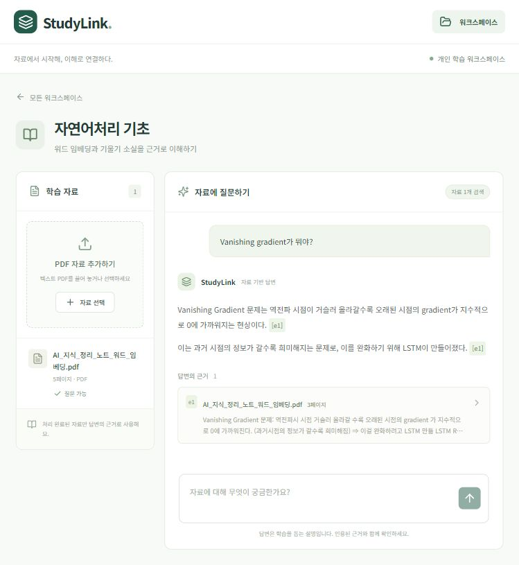

# 1일차 구현·통합 기록

작성일: 2026-10-21 (Asia/Seoul)
상태: 1일차 핵심 구현·자동 테스트·실제 GMS·브라우저 통합 확인 완료. 전체 3일 시제품 완료는 아니다.

## 작업 지시와 저장소

사용자가 프런트·백엔드·에이전트 개발 담당 3개 에이전트의 병렬 구현을 요청했다. [1일차 PRD](studylink-day1-prd.md)를 기준으로 새 Git 저장소 `D:\SSAFY\studylink`에서 구현한다. 기획·설계·용어 문서만 가져왔으며 실습 코드·가상환경·의존성 파일은 가져오지 않았다. 이후 제품 문서의 최신본은 이 저장소의 `docs/`다.

## 담당 경계

| 담당 | 소유 범위 | 검증 |
| --- | --- | --- |
| 프런트 에이전트 | frontend, 프런트 작업 기록 | 빌드·화면 동작 |
| 백엔드 에이전트 | API·설정·DB·스키마·PDF 수집 | API·자료 상태·영속화 |
| 에이전트 담당 | GMS·관측 어댑터, 검색·답변 서비스·그래프 | 외부 호출 대역·인용 검증·실패 분기 |
| 통합 담당 | 공통 실행 환경·README·통합 확인·문서 | 실제 PDF·GMS·trace·전체 테스트 |

세 담당은 공통 작업 디렉터리를 사용하고 파일 담당 범위를 나눠 충돌을 피한다. 자동 테스트는 PRD의 모듈 공개 동작을 대상으로 작성한다. 외부 이슈 트래커 게시와 원격 push는 이번 구현에 포함하지 않는다.

## 검증 결과

검증 환경: Windows, Python 3.12, Node.js 24.18.0. Python 직접 의존성과 전체 잠금 파일, 프런트 패키지 잠금 파일을 저장했다. `pip check`는 의존성 오류 없음이다.

| 항목 | 결과 | 근거 |
| --- | --- | --- |
| 자동 테스트 | 22개 통과 | 저장소 루트 `python -m pytest -q`, 최종 6.98초. API 5개·에이전트/어댑터 17개 |
| 프런트 빌드 | 통과 | `npm run build`, Vite 6.4.1 |
| 실제 PDF 수집 | 통과 | 워드 임베딩 5쪽을 실제 GMS 임베딩으로 수집하고 ready 확인 |
| 실제 답변 | 통과 | “Vanishing gradient가 뭐야?” → grounded, 문장 2개가 동일한 자료 p.3 인용. 최종 확인 2.38초 |
| 자료에 없는 질문 | 보류 | 제주도 내일 날씨 질문 → insufficient_evidence |
| 저장·재시작 | 통과 | 스크립트 앱 수명주기 재시작, 실제 uvicorn 프로세스 종료·재시작 후 브라우저에서 워크스페이스·ready 자료 유지와 재질문 확인 |
| 화면 연결 | 통과 | 브라우저에서 워크스페이스 생성·PDF 업로드·상태 전환·질문·인용 클릭·근거 패널 확인 |
| Langfuse | 전송·재조회·점검 통과 | 동일 trace의 관측 6개, 검색·생성·검증 계층, 모델·전체 프롬프트·입출력·토큰·요청 정보·개발 환경 확인 |

실제 답변의 p.3 발췌와 생성 문장을 에이전트가 대조했다. 별도 사람 평가와 15개 전체 평가 질문셋 판정은 수행하지 않았다. 위 수치는 소수 smoke 실행 결과이며 지연 보장이나 최종 검색 품질 평가가 아니다.

최종 [Langfuse trace](https://jp.cloud.langfuse.com/project/cmvhrl0210007ad0eth2n7am5/traces/44fba9f88e90c48c4adb83795f6d7af8): 채팅 gpt-4.1-mini 입력 564·출력 79토큰, 질문 임베딩 입력 8토큰. 생성 관측에는 실제 전송한 system·user 메시지와 프롬프트 버전 answer-v1을 남긴다. 선택 chunk_id·점수와 trace_id는 완료 답변과 함께 SQLite에 저장한다.

관측 점검은 [Langfuse 공식 지침](https://langfuse.com/docs/observability/best-practices)을 확인하고 CLI observations 조회로 수행했다. 최초 점검에서 누락된 system 메시지·프롬프트 버전·요청 식별·검증 입력을 보강한 뒤 새 trace를 재조회해 확인했다.

검증 원본 JSON은 Git 제외 경로 `backend/data/smoke-real/smoke-report.json`과 `trace-audit.json`에 있다. 화면 기록:

## 해결한 통합 문제

- 설정 경로를 저장소 루트 .env로 통일했다. GMS 키 이름은 문서대로 GMS_KEY를 우선 사용한다.
- 기존 설정의 GMS_BASE_URL이 웹 화면 `/web`을 가리켜 HTTP 405가 발생했다. 아키텍처에 사전 검증된 `/gmsapi/api.openai.com/v1`로 바로잡았고 `.env.example`과 실행 문서에도 구분했다. 비밀키 값은 기록하지 않는다.
- 숫자 페이지 줄과 반복 자료 제목을 분리해 제거하도록 수집을 보완했다.
- 관측 장애가 업무 예외를 삼키지 않는지 테스트하고, 서버 종료 시 flush를 추가했다.

## 진행 상태와 후속

세 담당 에이전트가 핵심 코드를 작성했다. 이후 사용량 한도로 중단되어 통합 담당이 남은 실행·설정 수정·빌드·관측 보강·문서를 직접 마무리했다. 중단된 담당이 계속 실행 중인 것으로 보고하지 않는다.

- 완료: 프런트·API·PDF 수집·페이지 청킹·검색·답변 그래프·인용 검증·출력 재생성 최대 1회·보류·저장·목 모드·관측. 출력 재생성은 원래 2일차 일정이었지만 이번 구현에 포함됐다.
- 2일차: 노트 CRUD·연결·색인·노트 검색 및 최소 1개 보장, 실제 질의 재작성/재검색, 근거 선택 기준값 보정, 노트 초안·관련 노트, PDF 화면 내 페이지 이동·답변 복구 화면.
- 이후: 퀴즈·채점·오답노트, 전체 평가 질문셋과 사람 평가, 일괄 재색인 관리 스크립트. 현재 모델을 바꾼 자료는 새 업로드로 다시 수집할 수 있다.
- 요청 한도 30초는 동기 HTTP 호출 전후의 협력적 검사다. 엄격한 wall-clock 중단을 보장하지 않는다. 시제품 후 강화할 사항으로 남긴다.
- 이슈 트래커 게시·원격 push는 수행하지 않았다. 로컬 새 저장소이며 실행 방법은 [README](../README.md)를 따른다.
